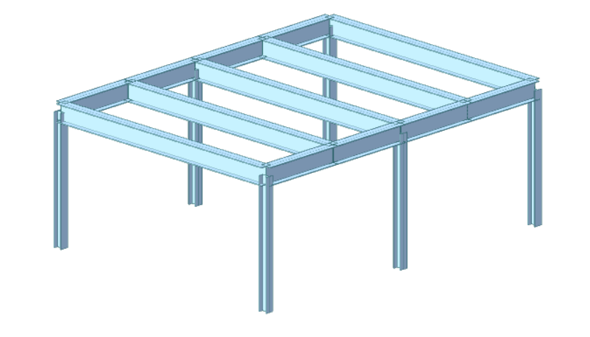

# 3-D SIMPLE 2–BAY FRAME

---



=== "Python"

    #### Complete Code      

    <div style="text-align: right; font-size: 0.8em;">
    <a href="https://github.com/MIDASIT-Co-Ltd/midas-civil-python/tree/main/examples" target="_blank" style="display: inline-flex; align-items: center; gap: 4px;">
        <svg height="16" width="16" viewBox="0 0 16 16" fill="currentColor" aria-hidden="true">
        <path d="M8 0C3.58 0 0 3.58 0 8c0 3.54 2.29 6.53 5.47 7.59.4.07.55-.17.55-.38 0-.19-.01-.82-.01-1.49-2.01.37-2.53-.49-2.69-.94-.09-.23-.48-.94-.82-1.13-.28-.15-.68-.52-.01-.53.63-.01 1.08.58 1.23.82.72 1.21 1.87.87 2.33.66.07-.52.28-.87.51-1.07-1.78-.2-3.64-.89-3.64-3.95 0-.87.31-1.59.82-2.15-.08-.2-.36-1.02.08-2.12 0 0 .67-.21 2.2.82.64-.18 1.32-.27 2-.27.68 0 1.36.09 2 .27 1.53-1.04 2.2-.82 2.2-.82.44 1.1.16 1.92.08 2.12.51.56.82 1.27.82 2.15 0 3.07-1.87 3.75-3.65 3.95.29.25.54.73.54 1.48 0 1.07-.01 1.93-.01 2.2 0 .21.15.46.55.38A8.013 8.013 0 0016 8c0-4.42-3.58-8-8-8z"/>
        </svg>
        Python codes
    </a>
    </div>

    ```python
    from midas_civil import *

    MAPI_KEY('xxxxxxxxxxxxxx')
    MAPI_BASEURL.autoURL()

    bay_width = 6
    bay_height = 3
    bay_length = 4

    no_bays = 2

    bay_len_div = 2

    #--------------- M A T E R I A L ------------------
    Material.STEEL('A36','ASTM(S)','A36')

    #--------------- S E C T I O N ------------------
    Section.DB('W8x35','H','AISC','W8x35',id=1)
    Section.DB('W16x67','H','AISC','W16x67',id=2)

    #--------------- G E O M E T R Y ------------------
    for i in range(no_bays+1):
        Element.Beam.SDL([i*bay_length,0,0],[0,0,1],bay_height,sect=1,angle=90)
        Element.Beam.SDL([i*bay_length,bay_width,0],[0,0,1],bay_height,sect=1,angle=90)
        Element.Beam.SDL([i*bay_length,0,bay_height],[0,1,0],bay_width,sect=2)

    for i in range(no_bays):
        Element.Beam.SDL([i*bay_length,0,bay_height],[1,0,0],bay_length,bay_len_div,sect=2)
        Element.Beam.SDL([i*bay_length,bay_width,bay_height],[1,0,0],bay_length,bay_len_div,sect=2)

        for j in range(bay_len_div-1):
            Element.Beam.SDL([i*bay_length+(j+1)*bay_length/bay_len_div,0,bay_height],[0,1,0],bay_width,sect=2)


    #--------------- S U P P O R T ------------------

    bottomNodeIDs = Model.Select.Box([0,0,0],[no_bays*bay_length,bay_width,0])
    Boundary.Support(bottomNodeIDs,'fix')

    #--------------- L O A D I N G ------------------

    Load.SW('Self Weight')

    topElementIDs = Model.Select.Box([0,0,bay_height],[no_bays*bay_length,bay_width,bay_height],'ELEM_ID')
    Load.Beam(topElementIDs,'Floor Load','',direction='GZ',D=[0,0.25,0.75,1],P=[0,-3,-3,0])

    fronNodeIDs = Model.Select.Box([0,0,bay_height],[0,bay_width,bay_height])
    Load.Nodal(fronNodeIDs,'Wind Load X','',FX = 60)

    SideElementIDs = Model.Select.Box([0,0,bay_height],[no_bays*bay_length,0,0],'ELEM_ID')
    Load.Beam(SideElementIDs,'Wind Load Y','',10,'GY')


    #--------------- D A T A   T O   C I V I L   N X ------------------

    Model.create()
    ```      

=== "Jupyter Notebook"
    #### Jupyter Notebbok   
    

    <div style="text-align: right; font-size: 0.8em;">
    [](https://colab.research.google.com/github/MIDASIT-Co-Ltd/midas-civil-python/blob/main/examples/jupyter%20notebook/Tut1%203D%20Simple%202-Bay%20Frame.ipynb)
    </div>
    
    <iframe width="1100" height="1000px" src="https://nbviewer.org/github/MIDASIT-Co-Ltd/midas-civil-python/blob/main/examples/jupyter%20notebook/Tut1%203D%20Simple%202-Bay%20Frame.ipynb" title="3D Simple 2bay frame" style="border: none;"></iframe>


=== "Interactive"    
    #### Web App   
    <iframe class="auto-iframe" height="500px" src="../../Examples/interactive/Tut1 3D Simple 2-Bay Frame.html" title="3D Simple 2bay frame" allowfullscreen style="border: none;"></iframe>
